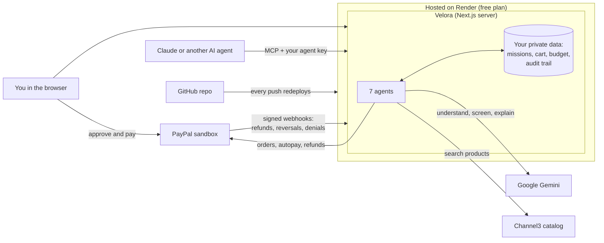
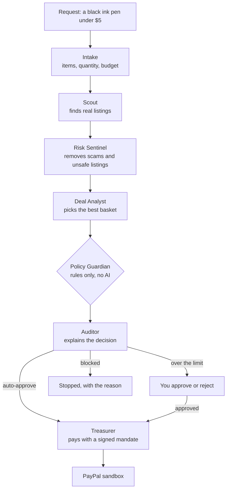

# Velora

Let AI agents shop without handing them your wallet.

AI agents can now buy things, but a single bad decision or a manipulated product listing can spend real money. Velora puts a team of specialist agents between a request and a PayPal payment. You set a budget and rules, and the agents can only spend inside them. Everything they do goes into a tamper-evident audit trail.

Built for the PayPal AI Hackathon. All payments use the PayPal sandbox. **[Try it live](https://paypal-ai-hackathon-by85.onrender.com)**

## Who it is for

People and small teams who want an AI agent to handle routine shopping, but won't hand it a payment method with no limits. Today the choice is to approve every purchase yourself, which removes the point of an agent, or to trust it completely. Velora adds a middle option: small, clean purchases happen on their own, bigger ones ask you first, and anything unsafe is stopped, with a record of why.

## What it does

- **Ask in plain language.** "Blue men's running shoes under $60" becomes items, a budget and preferences. You can also set gender, age group, colour and condition from a menu.
- **Real products.** Scout searches live listings and drops anything that is not really what you asked for.
- **Explore and choose.** Compare every screened option for an item, and switch to another. Limits are checked again and a new order is created.
- **Agent autopay.** Save a PayPal sandbox account once, and agents can pay by themselves when every check passes. Bigger purchases still wait for you, and autopay can be turned off at any time.
- **Cart.** Add products from several missions, change quantities, and pay for everything in one PayPal order with estimated tax.
- **Dashboard.** Charts of spending over time, outcomes, price ranges, categories, guardrail catches and purchases made by AI agents, plus trending products picked from screened listings. It updates by itself as missions finish.
- **Refunds and history.** Refund a purchase to restore the budget, and see every mission on the All missions page.
- **A safe wallet for any AI agent.** Claude, ChatGPT or any other MCP client can ask Velora to buy something. Their requests go through the same agents, limits, signed mandates and PayPal flow, and show up in your missions with the agent's name.
- **Safety test.** Plant a fake scam listing from the Customize menu and watch the Risk Sentinel catch it. It is the cheapest option, so it would win if it got through.

## Try it live

**[paypal-ai-hackathon-by85.onrender.com](https://paypal-ai-hackathon-by85.onrender.com)**

Everything on the live site is real: Gemini runs the agents, Channel3 finds real products, and payments go through the PayPal sandbox, so no real money moves.

To pay, log in on PayPal's page with your own PayPal sandbox **personal** account. To make one for free, sign in at [developer.paypal.com](https://developer.paypal.com) and open **Testing Tools > Sandbox Accounts**.

Your missions, cart and dashboard are private to your browser, and a new visitor starts with an empty app. The site runs on Render's free plan, so after 15 idle minutes it goes to sleep: the next visit takes about a minute to load, and earlier missions are cleared.

## Run it on your own machine

Requires Node 24 or newer.

```bash
git clone https://github.com/nikhilraghav018/Paypal-AI-Hackathon.git
cd Paypal-AI-Hackathon
npm install
cp .env.example .env.local
npm run dev
```

Open http://localhost:3000.

- **With no keys** it runs in demo mode: a fictional catalog, rule-based agents and simulated payments, each clearly tagged in the app.
- **With your own keys** it runs live. Add any of them to `.env.local` and restart, and that service switches on. `.env.example` says where to get each one, and all are free.

| Key in `.env.local` | Switches on |
| --- | --- |
| `GEMINI_API_KEY` | Gemini for the agents |
| `CHANNEL3_API_KEY` | Real product search |
| `PAYPAL_CLIENT_ID` and `PAYPAL_CLIENT_SECRET` | PayPal sandbox payments, autopay and refunds |
| `VELORA_MCP_TOKEN` | Lets AI agents shop through Velora (see below) |

With PayPal keys added, pay with your own PayPal sandbox **personal** account, as on the live site. **Live services** in the header shows which services are live and which are in demo mode.

## Let Claude or another AI agent buy for you (MCP)

Velora is also an [MCP](https://modelcontextprotocol.io) server, so Claude, ChatGPT or any other MCP client can shop through it. The agent can ask, but every request goes through your rules, and only you can approve more.

1. In Velora, open **Live services**, then **Connect an AI agent**, and click **Copy Claude Code command**. The command includes your own private agent key.
2. Paste it into your terminal. It looks like this:

   ```bash
   claude mcp add --transport http velora https://paypal-ai-hackathon-by85.onrender.com/api/mcp --header "Authorization: Bearer YOUR_AGENT_KEY"
   ```

3. Start `claude` and ask something like "Use Velora to buy me a black ink pen under $5."
4. The purchase appears in your missions in the same browser, marked "Asked by Claude via MCP". If it's within the agent limit and autopay is on, it pays by itself. Otherwise you approve and pay in Velora.

Other MCP clients use the same address and send the key as a bearer token. **New key** switches off the old one at once. On the live site, a server sleep also clears your key, so copy the command again if Claude reports a wrong key.

To use it on your own machine, set `VELORA_MCP_TOKEN` in `.env.local` to a long random secret (`openssl rand -hex 32`) and restart. This turns MCP on, and the copied command will point to `localhost`.

| Tool | What it does |
| --- | --- |
| `get_spending_rules` | Shows your limits, budget left this month, blocked categories and whether autopay is on. |
| `request_purchase` | Runs the full agent team on a request such as "a black ink pen under $5" and returns what was chosen, the decision and the next step. |
| `check_purchase` | Shows the status of an earlier request, for example after you approved it. |

There is deliberately no tool to approve, refund or change limits. A request over the agent limit waits for you in Velora, and a blocked one stays blocked however it is worded.

## The agent team

| Agent | Its one job | Uses |
| --- | --- | --- |
| Intake | Turns a sentence into items, quantities and a budget | Gemini, with rules as backup |
| Scout | Searches product listings | Channel3 |
| Risk Sentinel | Quarantines prompt injection, off-platform payment requests, implausible prices and restricted goods | Rules, plus Gemini, which can add warnings but never clear one |
| Deal Analyst | Chooses the best basket within budget | Gemini, with rules as backup |
| Policy Guardian | Decides: auto-approve, ask a human, or block | Rules only, by design |
| Auditor | Explains the decision in plain language | Gemini, with rules as backup |
| Treasurer | The only agent that can touch PayPal, and only with a signed mandate | PayPal Orders, Payments and Vault APIs |

## System design

### The whole system



### How the agents decide



Every step is written to a hash-chained audit trail, so any later edit to the record shows.

## Safety design

- **The AI cannot authorize spending.** The Policy Guardian is ordinary code. Model output only reaches it as a basket whose prices come from the catalog record.
- **Signed mandates.** Approval produces a short-lived signature tied to the mission, amount and exact basket. A changed basket or amount is refused.
- **Checks right before payment.** Policy runs again before the order is created. The mandate and PayPal order amount are both checked again before capture.
- **Budget reservations.** Pending checkouts count against the monthly budget, and refunds restore it.
- **Tamper-evident audit trail.** Each entry includes the hash of the one before it, so an edit breaks the chain.
- **Verified webhooks.** PayPal confirms each event's signature before a refund, reversal or denial made outside the app can change the budget.
- **Outside agents get no extra power.** MCP requests need the visitor's own agent key, share the app's rate limit, and can only ask and check. The key is separate from the browser cookie, so it can't be used to open the app and approve. The agent's name is recorded in the audit trail.
- **Private data for each visitor.** Each browser gets a random ID in a cookie on its first visit and its own missions, cart, budget, PayPal connection and dashboard. A new visitor starts with an empty app and sees nobody else's data.
- **Sandbox only.** The PayPal host is fixed in code, so the app cannot reach the live API.

## How PayPal is used

| PayPal capability | What it does here |
| --- | --- |
| Orders v2: create, get, capture | Each purchase is one order with itemised lines and a tax breakdown. Its amount is checked against the signed mandate before capture. |
| Vault v3: setup and payment tokens | The owner approves once on PayPal's page, then agents can pay with the saved account. |
| Payments v2: refund | Refunds a capture and restores the budget. |
| Webhooks and signature verification | Refunds, reversals and denials made outside the app update the budget, but only after PayPal verifies the event. |
| Request IDs and debug IDs | Repeated requests can't charge twice, and PayPal's debug ID is kept with any error. |
| Declines | When PayPal declines a payment method, nothing is charged and the payer can try another. |

## How Channel3 is used

Channel3 is the Scout agent's product catalog. Every request becomes a live search across real online stores.

| Channel3 feature | What it does here |
| --- | --- |
| Product search API | Scout sends each requested item as a search and gets up to 15 real listings, with title, brand, store, price, image and link. |
| In-stock and price filters | Only in-stock offers come back, and none above the mission's budget. |
| Gender, age and condition filters | Choices from the Customize menu, such as men's, kids or used, are sent as search filters. |
| Product colours | Colour is added to the search words, then each listing's colour data is checked so the results really match. |
| Categories | Each listing's category feeds the restricted-goods check, the look-alike filter and the dashboard's category charts. |
| Compare-at prices | Original prices help the Deal Analyst spot real discounts. |

Listings go through the Risk Sentinel before any agent can pick one, and prices always come from Channel3's record, never from the AI. If Channel3 is down or no key is set, Scout falls back to a labelled sample catalog.

## How Render is used

Render hosts the live site, so anyone can try Velora without installing anything or bringing their own keys.

| Render feature | What it does here |
| --- | --- |
| Free web service | Runs the Next.js server with the full app: agents, dashboard, PayPal flow and MCP server. |
| Deploys from GitHub | Every push to `main` rebuilds and redeploys the site on its own. |
| Environment variables | The Gemini, Channel3, PayPal sandbox and MCP secrets live in Render's settings, never in the code. |
| Free HTTPS address | Gives PayPal a secure address to return payers to and send signed webhooks to, and gives AI agents an address to reach over MCP. |

On the free plan the server sleeps after 15 idle minutes. The next visit takes about a minute to load, and missions saved before the sleep are cleared.

## PayPal Doctor review

We ran the full PayPal Doctor checklist from [PayPal's AI Toolkit](https://github.com/paypal/AI-Toolkit/blob/main/commands/doctor.md) against this code, using the toolkit's reference guides. It was run as a manual review, not through the plugin. The toolkit's sandbox connector wasn't used, so its live checks were replaced with direct calls to PayPal's sandbox.

**Result: 0 critical issues open.** Sections for features this app doesn't use (JS SDK, Pay Later, Venmo, Subscriptions) don't apply.

| Area | Result |
| --- | --- |
| Credentials | Passed. Secrets stay on the server in environment variables, and `.env*` files are ignored by git. |
| Authentication | Passed. Tokens are cached and refreshed using `expires_in`, and money-moving POST requests carry a `PayPal-Request-Id`. |
| Orders and checkout | Passed. Uses Orders v2, `INSTRUMENT_DECLINED` is handled separately, and amounts come from the server. |
| Webhooks | Passed in code and tests: signatures are verified and events are only applied once. Live delivery still needs a public HTTPS address. |

**Found and fixed in the review:**

| Warning | Fix |
| --- | --- |
| Capture ran without checking the order's status | The order must be approved before capture. |
| No retry for `429` and `5xx` errors | Retried with backoff using the same request ID, so a retry can't charge twice. |
| No cross-site protection on endpoints that spend money | Requests from other websites are refused in `src/proxy.ts`. |

**Left as they are, on purpose:**

| Finding | Why |
| --- | --- |
| Sandbox URL is hardcoded with no environment switch | This is the safety guarantee: the app cannot reach the live API. |
| Webhook handler returns `400` on a failed signature (info only) | An event that can't be verified shouldn't look accepted. |
| Token and signature-check requests have no request ID | Neither one moves money. |
| Local return URLs use HTTP | They only do so on `localhost`. Any hosted address must use HTTPS. |

## How AI and other tools are used

| Tool | How it is used |
| --- | --- |
| Google Gemini (free tier) | Understands requests, judges whether a listing is really what was asked for, reviews listings for deception, picks the best basket and explains decisions. If one model is busy another is tried, and if both are busy each agent falls back to rules. |
| Channel3 | Live product search with price, condition, gender and age filters. |
| Next.js, React, TypeScript, Tailwind CSS | The app and its server. |
| Model Context Protocol SDK | Lets outside AI agents use Velora as a tool. |
| Vitest | Automated tests, including simulated PayPal failures. |

## Try these

| Request | What should happen |
| --- | --- |
| Buy pens and copy paper under $30 | Clears the rules. In demo mode, a listing with hidden instructions is quarantined. |
| Buy an office chair under $150 | Waits for your approval because it is over the auto-approve limit. |
| Buy a red wine sampler | Blocked as a restricted category. |

Then try a refund, the cart, the safety test in **Customize**, and **Verify hash chain**.

## Tests

```bash
npm test
```

## Known limits

- Payments are sandbox only and no goods are shipped. Scout finds real listings when Channel3 is on, but the sandbox payment does not buy from those retailers.
- Without autopay, the payer approves each order on PayPal's page.
- Cart tax is a flat 8% estimate, because no shipping address is collected. Single-product purchases carry no tax.
- There are no accounts. Each visitor's data is tied to a cookie in their browser and saved as a file on the server, which suits a demo with one server process, not production.
- On Render's free plan, the server sleeps after 15 idle minutes and its files are cleared, so missions don't survive a sleep.

## License

MIT
